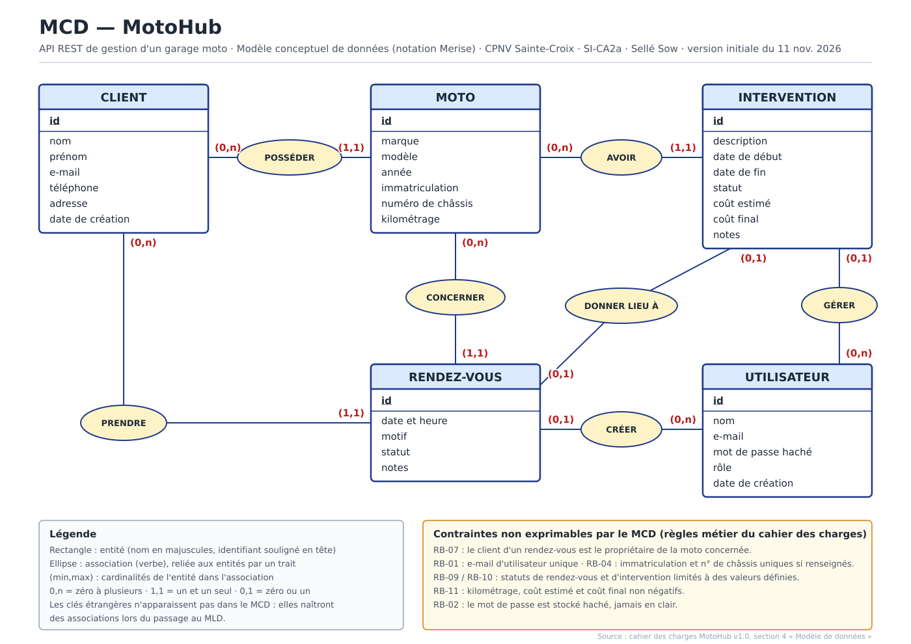

# MCD — Modèle conceptuel de données

> Version initiale du 11 nov. 2026, établie à partir de la section 4 « Modèle de données » du cahier des charges (`docs/cahier-des-charges.md`).
> **À relire et valider avant l'implémentation** (risque « erreurs de modélisation » du cahier des charges).

| Fichier | Usage |
|---|---|
| [`mcd/mcd-motohub.pdf`](mcd/mcd-motohub.pdf) | Livrable PDF (semaine 2, à déposer sur Teams) |
| [`mcd/mcd-motohub.svg`](mcd/mcd-motohub.svg) | Version vectorielle, affichée ci-dessous |

## Entités et attributs

Chaque entité a un identifiant `id`. Les clés étrangères (`client_id`, `moto_id`, `utilisateur_id`, `rendez_vous_id`) ne figurent pas dans le MCD : elles résulteront des associations au passage au MLD.

| Entité | Attributs | Contraintes issues des règles métier |
|---|---|---|
| UTILISATEUR | id, nom, e-mail, mot de passe haché, rôle, date de création | e-mail unique (RB-01) ; mot de passe jamais en clair (RB-02) |
| CLIENT | id, nom, prénom, e-mail, téléphone, adresse, date de création | — |
| MOTO | id, marque, modèle, année, immatriculation, numéro de châssis, kilométrage | immatriculation et numéro de châssis uniques s'ils sont renseignés (RB-04) ; kilométrage non négatif (RB-11) |
| RENDEZ-VOUS | id, date et heure, motif, statut, notes | date valide et conflits de créneau signalés (RB-08) ; statut parmi des valeurs définies (RB-09) |
| INTERVENTION | id, description, date de début, date de fin, statut, coût estimé, coût final, notes | statut parmi des valeurs définies (RB-10) ; montants non négatifs (RB-11) |

## Associations et cardinalités

| Association | Entité (min,max) | Entité (min,max) | Justification dans le cahier des charges |
|---|---|---|---|
| POSSÉDER | CLIENT (0,n) | MOTO (1,1) | « Un Client possède zéro à plusieurs Motos. Une Moto appartient à un seul Client. » (RB-03, RB-05) |
| PRENDRE | CLIENT (0,n) | RENDEZ-VOUS (1,1) | « Un Client peut avoir zéro à plusieurs Rendez-vous » ; un rendez-vous référence un client existant (RB-06) |
| CONCERNER | MOTO (0,n) | RENDEZ-VOUS (1,1) | « Une Moto peut faire l'objet de zéro à plusieurs Rendez-vous » ; un rendez-vous référence une moto existante (RB-06) |
| AVOIR | MOTO (0,n) | INTERVENTION (1,1) | « Une Moto possède zéro à plusieurs Interventions » ; une intervention référence une moto existante (RB-10) |
| DONNER LIEU À | RENDEZ-VOUS (0,1) | INTERVENTION (0,1) | « Un Rendez-vous peut être associé à zéro ou une Intervention » |
| CRÉER | UTILISATEUR (0,n) | RENDEZ-VOUS (0,1) | Un rendez-vous « peut être créé par un Utilisateur » ; un utilisateur peut en créer plusieurs |
| GÉRER | UTILISATEUR (0,n) | INTERVENTION (0,1) | « Un Utilisateur peut créer ou gérer plusieurs Rendez-vous et Interventions » |

## Points à valider

Choix de lecture du cahier des charges à confirmer (et à pouvoir expliquer à l'oral) :

- **Utilisateur – Intervention** : le cahier ne dit pas si l'utilisateur d'une intervention est obligatoire. Lecture retenue (0,1), par symétrie avec le rendez-vous (« peut être créé par »).
- **Intervention – Rendez-vous** : une intervention peut exister sans rendez-vous (seule la moto est exigée par RB-10), d'où (0,1) des deux côtés.
- **Client porté par le rendez-vous** : le rendez-vous référence à la fois la moto et le client, alors que la moto a déjà un propriétaire. Le cahier le prévoit et ajoute la règle RB-07 (le client du rendez-vous doit être le propriétaire de la moto), que les cardinalités ne peuvent pas exprimer. À reprendre lors du MLD.
- **Rôle** : les valeurs possibles ne sont pas définies dans le cahier des charges.
- **Statuts** : le cahier ne donne que des exemples (planifié, confirmé, réalisé, annulé ; ouverte, en cours, terminée, annulée), à figer.
- **Conventions CPNV de modélisation** : elles ne figurent pas dans les documents fournis. Notation Merise standard utilisée ; à vérifier (noms, notation, présentation).
