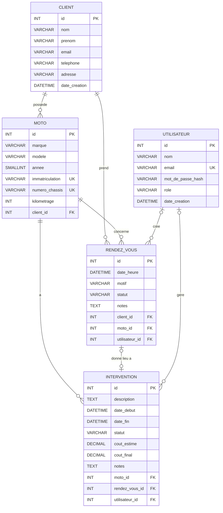

# MLD — Modèle logique des données

> Version initiale du 18 nov. 2026, obtenue en transformant le MCD (`docs/mcd.md`) pour MySQL.
> **À relire et valider avant l'implémentation** (risque « erreurs de modélisation » du cahier des charges).

## Règles de passage MCD → MLD

- Chaque entité devient une table ; l'identifiant `id` devient la clé primaire (`INT UNSIGNED AUTO_INCREMENT`).
- Les associations de cardinalité (x,n) – (1,1) deviennent une clé étrangère **obligatoire** (`NOT NULL`) du côté (1,1) : `moto.client_id`, `rendez_vous.client_id`, `rendez_vous.moto_id`, `intervention.moto_id`.
- Les associations (0,1) – (0,n) deviennent une clé étrangère **facultative** (`NULL`) : `rendez_vous.utilisateur_id`, `intervention.utilisateur_id`.
- L'association (0,1) – (0,1) entre rendez-vous et intervention devient `intervention.rendez_vous_id` (`NULL`, `UNIQUE`) : l'unicité garantit « au plus une intervention par rendez-vous ».
- Aucune association (n,n) : pas de table de liaison.

## Schéma relationnel

Notation : <u>clé primaire</u> soulignée, `#` = clé étrangère.

- **utilisateur** (<u>id</u>, nom, email, mot_de_passe_hash, role, date_creation)
- **client** (<u>id</u>, nom, prenom, email, telephone, adresse, date_creation)
- **moto** (<u>id</u>, marque, modele, annee, immatriculation, numero_chassis, kilometrage, #client_id)
- **rendez_vous** (<u>id</u>, date_heure, motif, statut, notes, #client_id, #moto_id, #utilisateur_id)
- **intervention** (<u>id</u>, description, date_debut, date_fin, statut, cout_estime, cout_final, notes, #moto_id, #rendez_vous_id, #utilisateur_id)

## Diagramme

## Dictionnaire des tables

### utilisateur

| Colonne | Type | Contraintes |
|---|---|---|
| id | INT UNSIGNED | PK, AUTO_INCREMENT |
| nom | VARCHAR(100) | NOT NULL |
| email | VARCHAR(255) | NOT NULL, UNIQUE (RB-01) |
| mot_de_passe_hash | VARCHAR(255) | NOT NULL (RB-02, jamais en clair) |
| role | VARCHAR(20) | NOT NULL, valeurs à figer (voir points à valider) |
| date_creation | DATETIME | NOT NULL, défaut `CURRENT_TIMESTAMP` |

### client

| Colonne | Type | Contraintes |
|---|---|---|
| id | INT UNSIGNED | PK, AUTO_INCREMENT |
| nom | VARCHAR(100) | NOT NULL |
| prenom | VARCHAR(100) | NOT NULL |
| email | VARCHAR(255) | NULL |
| telephone | VARCHAR(30) | NULL |
| adresse | VARCHAR(255) | NULL |
| date_creation | DATETIME | NOT NULL, défaut `CURRENT_TIMESTAMP` |

### moto

| Colonne | Type | Contraintes |
|---|---|---|
| id | INT UNSIGNED | PK, AUTO_INCREMENT |
| marque | VARCHAR(50) | NOT NULL |
| modele | VARCHAR(50) | NOT NULL |
| annee | SMALLINT UNSIGNED | NULL |
| immatriculation | VARCHAR(20) | NULL, UNIQUE (RB-04) |
| numero_chassis | VARCHAR(30) | NULL, UNIQUE (RB-04) |
| kilometrage | INT UNSIGNED | NOT NULL, défaut 0, `CHECK (kilometrage >= 0)` (RB-11) |
| client_id | INT UNSIGNED | NOT NULL, FK → client(id) (RB-03, RB-05) |

Une clé `UNIQUE (id, client_id)` complète la table : elle sert de cible à la clé étrangère composite de `rendez_vous` (RB-07).

### rendez_vous

| Colonne | Type | Contraintes |
|---|---|---|
| id | INT UNSIGNED | PK, AUTO_INCREMENT |
| date_heure | DATETIME | NOT NULL (RB-08) |
| motif | VARCHAR(255) | NOT NULL |
| statut | VARCHAR(20) | NOT NULL, défaut `planifie`, `CHECK` sur les valeurs (RB-09) |
| notes | TEXT | NULL |
| client_id | INT UNSIGNED | NOT NULL, FK → client(id) (RB-06) |
| moto_id | INT UNSIGNED | NOT NULL, FK → moto(id) (RB-06) |
| utilisateur_id | INT UNSIGNED | NULL, FK → utilisateur(id) |

Clé étrangère composite `(moto_id, client_id)` → `moto(id, client_id)` : le client du rendez-vous est forcément le propriétaire de la moto (RB-07), garanti par la base.

### intervention

| Colonne | Type | Contraintes |
|---|---|---|
| id | INT UNSIGNED | PK, AUTO_INCREMENT |
| description | TEXT | NOT NULL |
| date_debut | DATETIME | NULL |
| date_fin | DATETIME | NULL, `CHECK (date_fin IS NULL OR date_debut IS NULL OR date_fin >= date_debut)` |
| statut | VARCHAR(20) | NOT NULL, défaut `ouverte`, `CHECK` sur les valeurs (RB-10) |
| cout_estime | DECIMAL(10,2) | NULL, `CHECK (cout_estime >= 0)` (RB-11) |
| cout_final | DECIMAL(10,2) | NULL, `CHECK (cout_final >= 0)` (RB-11) |
| notes | TEXT | NULL |
| moto_id | INT UNSIGNED | NOT NULL, FK → moto(id) (RB-10) |
| rendez_vous_id | INT UNSIGNED | NULL, UNIQUE, FK → rendez_vous(id) |
| utilisateur_id | INT UNSIGNED | NULL, FK → utilisateur(id) |

## Clés étrangères et suppression (RB-13)

Les clés étrangères entre données métier utilisent `ON DELETE RESTRICT` : supprimer un client, une moto ou un rendez-vous encore référencé échoue et l'API répond `409 Conflict`. Exception proposée : `utilisateur_id` en `ON DELETE SET NULL`, pour conserver l'historique quand un compte est supprimé.

| Table.colonne | Référence | ON DELETE |
|---|---|---|
| moto.client_id | client.id | RESTRICT |
| rendez_vous.client_id | client.id | RESTRICT |
| rendez_vous.(moto_id, client_id) | moto.(id, client_id) | RESTRICT |
| rendez_vous.utilisateur_id | utilisateur.id | SET NULL |
| intervention.moto_id | moto.id | RESTRICT |
| intervention.rendez_vous_id | rendez_vous.id | RESTRICT |
| intervention.utilisateur_id | utilisateur.id | SET NULL |

## Points à valider

- **RB-07** : résolue dans le MLD par la clé composite `(moto_id, client_id)`. `rendez_vous.client_id` reste une colonne redondante avec `moto.client_id`, mais voulue (le cahier des charges demande que le rendez-vous référence le client). Si la clé composite est jugée trop complexe, repli possible : supprimer `rendez_vous.client_id` et vérifier RB-07 côté service.
- **Rôle et statuts** : valeurs non définies dans le cahier des charges. Valeurs proposées : rôle `admin` / `mecanicien` ; rendez-vous `planifie`, `confirme`, `realise`, `annule` ; intervention `ouverte`, `en_cours`, `terminee`, `annulee`. À figer.
- **Contraintes `CHECK`** : appliquées seulement à partir de MySQL 8.0.16 ; en dessous, elles seraient ignorées et la validation reposerait sur l'API.
- **Conflits de créneau (RB-08)** : non exprimables en contrainte simple, contrôlés dans le service.
- **Noms** : snake_case minuscule, tables au singulier, sans accents. Conventions CPNV non fournies : à vérifier.
